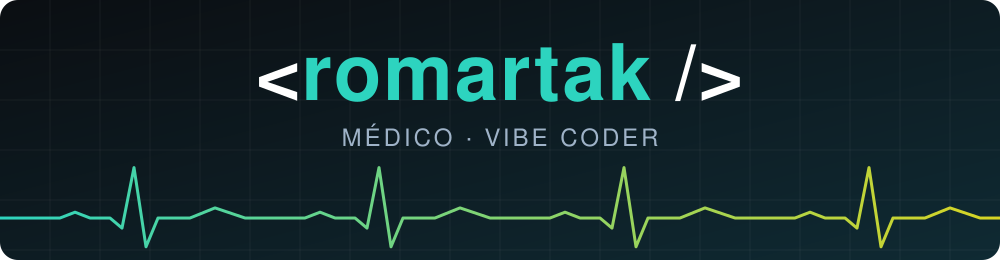

<div align="center">



<picture>
  <source media="(prefers-color-scheme: dark)" srcset="profiles/default/dark.svg">
  <source media="(prefers-color-scheme: light)" srcset="profiles/default/light.svg">
  
</picture>



**🩺 Médico · ⚡ Vibe coder**
<br>
*Medical student · Vibe coder*

[](https://github.com/romartak/sdrkit)


</div>

---

## 👋 Sobre mí · About me

Soy **médico en formación** y me apasiona el **vibe coding** y el **desarrollo de proyectos**: convertir ideas en
herramientas que funcionan, que se documentan bien y que cualquiera puede usar y mejorar.

I'm a **medical student** (a doctor in the making) who loves **vibe coding** and **building projects**: turning ideas
into tools that work, are well documented, and that anyone can use and improve.

## 🚀 Proyecto destacado · Featured project

<table>
<tr>
<td width="60%" valign="top">

### 📡 [SDR-Kit](https://github.com/romartak/sdrkit)

Analizador de espectro, radio multimodo y decodificador de bolsillo con una **Raspberry Pi Zero 2 W** y un
**RTL-SDR**, manejado desde el celular.

- 🔌 Instalación con un comando
- 🛟 Actualizaciones que vuelven solas atrás si algo falla
- 🌍 Panel, instalador y comandos en **español e inglés**
- 🧪 Tests y CI en cada cambio

</td>
<td width="40%" valign="top">

```text
 📱 celular
   ⇅ WiFi / hotspot
 🥧 Raspberry Pi Zero 2 W
   ⇅ USB
 📡 RTL-SDR
 0.5 → 1766 MHz
```

[](https://github.com/romartak/sdrkit)

</td>
</tr>
</table>

## 🛠️ Herramientas · Toolbox


## 🎯 Lo que me mueve · What drives me

| 🩺 Medicina | 💻 Código | 🤝 Comunidad |
|---|---|---|
| Rigor, método y cuidado por las personas, al servicio del desarrollo de la sociedad y de la medicina | Soluciones claras, probadas y documentadas, a medio camino entre el vibe coding y la medicina | Proyectos que siempre he querido realizar, ligados a mis investigaciones personales |

<sub>🩺 Medicine: rigor, method and care for people, in service of society and of medicine · 💻 Code: clear, tested, documented solutions where vibe coding meets medicine · 🤝 Community: projects I've always wanted to build, tied to my personal research</sub>

## 📊 GitHub

<div align="center">


</div>

<details>
<summary>📬 <b>Colaboremos · Let's collaborate</b></summary>

<br>

¿Ideas, errores o quieres sumarte? Abre un *issue* en [SDR-Kit](https://github.com/romartak/sdrkit/issues) —
se aceptan contribuciones en español e inglés.

Ideas, bugs, or want to join in? Open an issue on [SDR-Kit](https://github.com/romartak/sdrkit/issues) —
contributions in Spanish and English are welcome.

</details>
